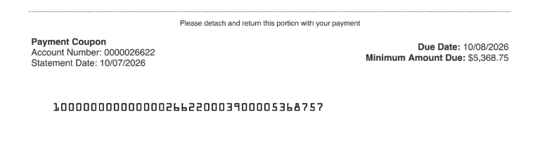
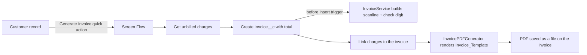

# Invoice Automation with Bank-Readable OCR-A Scanlines (Salesforce)

A portfolio rebuild of an invoicing automation I designed for an insurance billing operation. Salesforce generates each invoice as a PDF with an OCR-A scanline at the bottom, so insureds can mail payment straight to the bank's lockbox and the payment comes back to Salesforce as data.

All names, numbers, and records in this repository are synthetic.

## Why it was built

**Before:** insureds mailed checks to the office. Someone collected them from the mail room, drove them to the bank to deposit, and then keyed the payment details into Salesforce by hand.

**After:** every invoice carries a scanline that identifies the customer and the amount due. Insureds send payment directly to the bank. The bank's lockbox equipment reads the scanline, deposits the check, and returns a payment file that is loaded into Salesforce, so payments are matched to the right account without anyone handling a check or retyping a number.

This repository contains the invoice side of that loop: collecting unbilled charges, creating the invoice, generating the scanline, and rendering the PDF. The bank's return file is processed by a separate component, described in [What comes back from the bank](#what-comes-back-from-the-bank) but not included as code.

### The payment coupon

The tear-off coupon from a production invoice. The account number is an internal Salesforce ID, and the scanline at the bottom is assembled from OCR-A glyph images (see below). The production scanline layout differs slightly from this demo's format.



## How the automation works



1. A user clicks **Generate Invoice** on a customer record.
2. The **Generate Customer Invoice** Screen Flow finds the customer's unbilled charges, totals them, creates the invoice, and links each charge to it.
3. **InvoiceTrigger** fires before insert and calls **InvoiceService** to build the scanline (bulkified: one query for all customers in the batch).
4. The flow calls **InvoicePDFGenerator**, an invocable Apex action that renders the Visualforce invoice template as a PDF and saves it as a file on the invoice record.

## The scanline

The scanline is the line of machine-readable characters at the bottom of the invoice. The bank's reader uses it to know who paid and how much was due.

```
[Routing: 5 digits][Customer number: 10 digits][Amount in cents: 8 digits][Check digit: 1 digit]
```

Example: `123450000000005007500000`

| Part | Value | Meaning |
|---|---|---|
| Routing | `12345` | Fixed prefix that identifies the biller |
| Customer number | `0000000005` | Customer C-00005, zero padded to 10 digits |
| Amount | `00750000` | $7,500.00 in cents, zero padded to 8 digits |
| Check digit | `0` | Validates the other 23 digits |

### Check digit algorithm

`InvoiceService.calculateCheckDigit` uses a weighted modulo 10 check:

1. Starting from the rightmost digit, multiply digits by alternating weights of 3 and 1.
2. Add the results.
3. The check digit is the number that brings the sum up to the next multiple of 10.

When the bank's equipment reads a scanline, it recomputes the check digit. A single misread digit always produces a mismatch, and so do most swapped pairs of neighboring digits, so a bad read gets flagged for review instead of posting a payment to the wrong account.

### Assembling the scanline from OCR-A glyphs

Lockbox readers expect the OCR-A typeface, with exact character shapes and spacing. Salesforce's PDF renderer does not reliably embed custom fonts like OCR-A, so the scanline is drawn as a row of individual glyph images:

- `OCRAGlyphs` is a static resource with one image per character (0-9 and A-Z).
- `OCRAScanlineController` splits the scanline string into characters and keeps only the ones that have a glyph.
- The `OCRA_Scanline` Visualforce component places the matching glyph image for each character at a fixed height with no padding, so the printed line keeps consistent character spacing for the bank's reader.

The `OCRAFont` static resource (the TrueType font) is included for reference; the PDF uses the glyph images.

## What comes back from the bank

After the lockbox processes the day's payments, the bank sends a fixed-width text file back. A synthetic example (made-up values, simplified layout):

```
1 DEMOBANK 20261008 0615
5 LOCKBOX 999999 BATCH 001
6 001 0001 INV-00042 C-00005 000750000 CHK 001042
6 001 0002 INV-00043 C-00011 000125050 CHK 000318
7 001 0002 000875050
9 0002 000875050
```

| First character | Line type | Contents |
|---|---|---|
| `1` | File header | Sending bank, date, time |
| `5` | Batch header | Lockbox and batch number |
| `6` | Payment detail | Invoice number, customer number, amount, check number |
| `7` | Batch trailer | Item count and batch total |
| `9` | File trailer | Item count and file total |

How Salesforce decodes it:

1. The bank posts the file to a Salesforce REST endpoint, and the raw text is stored on a record.
2. Each line becomes its own record, typed by its first character.
3. Payment lines (type `6`) are matched to their invoice by invoice number. Amounts use an implied decimal, so `000750000` becomes $7,500.00.
4. A trigger hands matched payments to asynchronous Apex, which creates the cash receipts against the invoice.
5. The trailer lines (types `7` and `9`) carry counts and totals for checking the batch.

## Components

| Type | Name | Purpose |
|---|---|---|
| Custom objects | `Customer__c`, `Invoice__c`, `Charge__c` | Customers, invoices, and the charges billed on them |
| Apex | `InvoiceService` | Scanline assembly and check digit calculation |
| Apex | `InvoicePDFGenerator` | Invocable action: renders the PDF and saves it to the invoice |
| Apex | `InvoiceTemplateController` | Data for the Visualforce invoice template |
| Apex | `OCRAScanlineController` | Splits the scanline into glyph characters |
| Trigger | `InvoiceTrigger` | Generates the scanline before insert and update |
| Visualforce | `Invoice_Template` page, `OCRA_Scanline` component | Invoice PDF layout and scanline rendering |
| Flow | `Generate_Customer_Invoice` | Screen Flow behind the quick action |
| Quick action | `Customer__c.Generate_Invoice` | Starts the flow from a customer record |
| Static resources | `OCRAGlyphs`, `OCRAFont` | Glyph images and the reference font |
| Permission set | `Invoice_Demo_Admin` | Access to the objects, tabs, and classes |

## PDF rendering notes

Salesforce renders Visualforce PDFs with an older HTML engine that ignores most CSS in `<style>` blocks. The invoice template uses inline styles for layout, which is also what keeps the scanline glyphs aligned.

## Try it

```bash
sf project deploy start --source-dir force-app
sf org assign permset --name Invoice_Demo_Admin
sf apex run --file create-new-customer-and-charges.apex
```

The script creates a sample customer with three unbilled charges totaling $7,500.00. Open the customer, click **Generate Invoice**, and the PDF appears under the invoice's files.

## License

MIT
